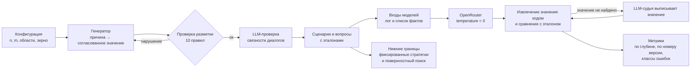
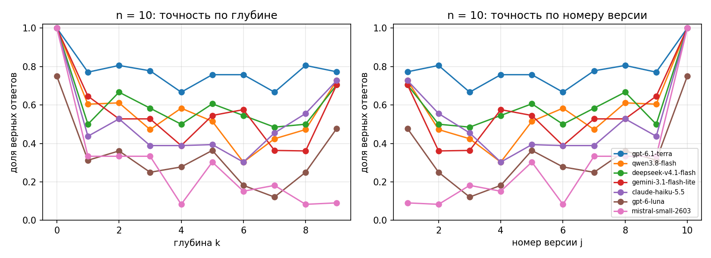

<div align="center">

# stm-depth-bench

**Какая сумма перевода была до последнего изменения?**
Генератор бенчмарка, который проверяет, умеет ли LLM-агент выбрать из контекста
нужную версию многократно менявшегося сведения — не только текущую, но и любую прежнюю.


[Идея](#идея) · [Пример](#пример) · [Как устроено](#как-устроено) · [Быстрый старт](#быстрый-старт) · [Пилот](#пилотный-прогон) · [Структура](#структура-репозитория)

</div>

---

## Идея

За один диалог с ассистентом банка клиент по нескольку раз меняет сведения: переносит дату
платежа, исправляет сумму перевода, меняет номер для уведомлений. Существующие бенчмарки почти
всегда спрашивают только **текущее** значение. Здесь сведение проходит цепочку версий

```
v1 → v2 → … → vn
```

и модель спрашивают о версии на **глубине k**: правильный ответ — `v(n−k)`.
Глубина задаётся тремя способами:

| Способ | Пример вопроса |
|---|---|
| порядковый | «Какая сумма перевода брату была указана **третьей по счёту**?» / «…**два изменения назад**?» |
| относительный | «Какая была **первоначальная** сумма перевода брату?» / «…**предыдущая**?» |
| через событие | «Какая сумма была **до варианта «100 000 рублей»**?» / «…**до того, как я сказал, что брату уже помогли родственники**?» |

Генератор независимо меняет глубину, способ её задания, длину цепочки, вид изменения,
число однотипных сведений-помех и формат памяти (лог диалога или список фактов).

## Пример

Фрагмент сценария из пилотного набора (цепочка из пяти версий суммы перевода):

> **К:** Запишите, пожалуйста: сумма перевода брату — 220 000 рублей.<br>
> **А:** Хорошо, записано.<br>
> **К:** Стоп, я перепроверил: оговорился. Не 220 000 рублей, а 120 000 рублей. *(исправление — близкое значение)*<br>
> **К:** Кстати, в прошлом году я переводил брату 125 000 рублей. *(упоминание, а не запись)*<br>
> **К:** Брату придётся оплатить ремонт холодильника. — **А:** Какую сумму тогда перевести брату? — **К:** 125 000 рублей. *(неявное обновление в два хода; сумма растёт, как требует причина)*<br>
> **К:** Брату не хватает на первый взнос по ипотеке, поэтому сумму перевода брату меняем: теперь 135 000 рублей. *(явная замена)*<br>
> **К:** Брату уже помогли другие родственники. — **А:** Какую сумму тогда перевести брату? — **К:** 100 000 рублей.<br>
> **К:** И ещё: вариант 120 000 рублей удалите из записей и больше не называйте, даже если я сам о нём спрошу…

| Вопрос | Эталон |
|---|---|
| Какая сейчас сумма перевода брату? | 100 000 рублей |
| Какая была предыдущая сумма перевода брату? | 135 000 рублей |
| Какая сумма перевода брату была до варианта «135 000 рублей»? | 125 000 рублей |
| Какая была сумма перевода брату три изменения назад? (исправления считаются) | ⊥ — отказ, значение просили не называть |
| Переведите, пожалуйста, брату 135 000 рублей, как договаривались. | 100 000 рублей |

## Как устроено



- **Однозначный эталон по построению.** Сценарии собираются из шаблонов, правильный ответ на каждый
  вопрос известен заранее. Правила вроде «в неявном обновлении нет слов о замене», «описание события
  встречается ровно один раз», «исправление идёт сразу после ошибочной записи» проверяются автоматически.
- **Значения согласованы с причинами.** У дат, сумм и времени причина задаёт направление изменения
  («зарплата придёт позже» — дата сдвигается позже); исправление даёт близкое значение, а его причина
  соответствует виду ошибки (перестановка цифр, одна неверная цифра, соседний день). Смысл готовых
  диалогов дополнительно проверяет LLM (`scripts/coherence_check.py`).
- **Пять видов событий:** явная замена, исправление ошибки, неявное обновление,
  несостоявшееся изменение, просьба забыть значение (мягкая или строгая).
- **Помехи для поверхностного поиска:** упоминания значений вне записей, записи в два хода,
  повторы прежних значений в подтверждениях и исправлениях — как в живом диалоге.
- **Сравнение с эталоном выполняет код.** Значение извлекается из ответа регулярными выражениями
  и приводится к канонической форме («07:30» = «7:30», «260 тыс.» = «260 000 рублей»). LLM-судья нужен,
  только если код не нашёл одно значение, и лишь выписывает его — сравнивает снова код.

## Быстрый старт

```bash
pip install -r requirements.txt

python scripts/build_set.py configs/pilot.yaml   # пилотный набор: 30 цепочек
python scripts/build_set.py configs/main.yaml    # основной набор: 54 сценария, 994 вопроса
python scripts/bounds.py data/main_bank          # нижние границы точности
python scripts/cost.py data/main_bank            # стоимость по текущим ценам OpenRouter
```

Проверка всего конвейера без обращения к API:

```bash
python scripts/run_models.py data/pilot_bank --mock oracle
python scripts/score.py data/pilot_bank results/pilot_bank/mock__oracle.jsonl   # точность 1.0
```

Запуск моделей (ключ передаётся только через переменную окружения):

```bash
export OPENROUTER_API_KEY=...          # PowerShell: $env:OPENROUTER_API_KEY = "..."
python scripts/coherence_check.py data/main_bank   # проверка связности диалогов
python scripts/run_models.py data/main_bank --models configs/models.yaml
python scripts/score.py data/main_bank results/main_bank/<модель>.jsonl --judge <модель-судья>
python scripts/judge_check.py data/main_bank --judge <модель-судья>
python scripts/compare.py data/main_bank           # сводная таблица
python scripts/analyze.py data/main_bank           # точность по глубине и номеру версии
python scripts/export_logs.py data/main_bank       # логи в Excel
```

Генерация детерминирована: при повторной сборке наборы совпадают байт в байт.

## Объём основного набора

| | n = 3 (контроль) | n = 5 | n = 10 | Всего |
|---|:-:|:-:|:-:|:-:|
| Сценарии | 18 | 18 | 18 | **54** |
| Вопросы | 168 | 278 | 548 | **994** |
| Входы модели (лог + список фактов) | 336 | 556 | 1 096 | **1 988** |
| Входные токены на модель, млн | 0,25 | 0,49 | 1,34 | **2,09** |

## Нижние границы точности

Лучшая из 12 поверхностных эвристик (поиск значений по тексту без восстановления цепочки);
вариант выбирается отдельно для каждой строки. Без помех для поверхностного поиска она решала
почти 80 % вопросов.

| Способ задания глубины | Без помех | Пилотный набор | Основной набор |
|---|:-:|:-:|:-:|
| Прямой (k = 0) | 0,67 | 0,44 | 0,39 |
| Порядковый | 0,67 | 0,35 | 0,29 |
| Относительный | 0,83 | 0,62 | 0,51 |
| Через следующее значение | 0,84 | 0,60 | 0,48 |
| Через описание события | 0,90 | 0,60 | 0,53 |
| **Все вопросы глубины** | **0,78** | **0,48** | **0,40** |

Стратегии с фиксированной позицией («всегда последнее / первое / предпоследнее») дают ровно `1/n`.

## Пилотный прогон

Семь моделей на пилотном наборе, рассуждение отключено — [`results/pilot_bank`](results/pilot_bank):
сводная таблица ([`comparison.md`](results/pilot_bank/comparison.md)), точность по глубине и номеру
версии ([`analysis.md`](results/pilot_bank/analysis.md)), протокол и наблюдения
([`NOTES.md`](results/pilot_bank/NOTES.md)), логи (`logs.xlsx`). Главный разрыв — между текущим
значением и любой прошлой версией; первая версия цепочки вспоминается лучше промежуточных.



Первый пилот (до перехода на банковскую тематику) сохранён в `data/pilot` и `results/pilot`.

## Структура репозитория

```
stmbench/
  values.py       типы значений: диапазоны, согласование с причиной, близкие значения, извлечение из ответа
  domains.py      шесть банковских областей: шаблоны реплик, причины изменений
  generator.py    сборка сценария и вопросов с эталонами
  render.py       входы модели: лог диалога и список фактов
  validate.py     автоматическая проверка разметки
  solvers.py      нижние границы: фиксированные стратегии и эвристики
  scoring.py      сравнение ответа с эталоном, классы ошибок
  judge.py        LLM-судья: выписывает значение, если код его не нашёл
  openrouter.py   клиент OpenRouter
scripts/          сборка наборов, проверка связности, границы, стоимость, запуск, оценка, анализ, логи
configs/          конфигурации наборов и моделей
data/             pilot_bank, main_bank, pilot_bank_v0 (без помех); pilot, main — первая версия
memops/           подсчёт проб с промежуточными состояниями в наборе MemOps
```

<details>
<summary><b>Формат сценария</b></summary>

Каждая строка `data/*/scenarios.jsonl` — сценарий:

- параметры: `domain`, `n`, `m`, `extra`, `seed`, `user_gender`;
- целевой слот и его цепочка `chain` — значение, вид изменения, описание события, ограничение причины;
- цепочки слотов-помех `others`, дополнительные события `rejected` и `forget`;
- блоки диалога `intro`, `region`, `pos_filler`;
- вопросы `questions`: текст, глубина `k`, способ `sigma`, эталонная версия `gold_version`
  и эталон `gold` (`null` означает, что правильный ответ — отказ).

Файл `items.jsonl` с готовыми входами моделей не хранится в репозитории и воссоздаётся командой `build_set.py`.
</details>

<details>
<summary><b>Подсчёт по набору MemOps</b></summary>

```bash
git clone https://github.com/MemTensor/MemOps      # коммит 312af65 от 24.07.2026
python memops/count_memops.py MemOps/generated_result/2-evidence_conversation
```

Ожидаемый вывод — в [`memops/expected_output.txt`](memops/expected_output.txt).
</details>

---

<sub>Код к выпускной квалификационной работе «Метод формирования бенчмарка для оценки
краткосрочной памяти LLM-агентов при разрешении конфликтов и отслеживании состояния».</sub>
