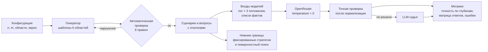

<div align="center">

# stm-depth-bench

**Какой адрес был до последнего изменения?**
Генератор бенчмарка, который проверяет, умеет ли LLM-агент выбрать из контекста
нужную версию многократно менявшегося сведения — не только текущую, но и любую прежнюю.


[Идея](#идея) · [Пример](#пример) · [Как устроено](#как-устроено) · [Быстрый старт](#быстрый-старт) · [Результаты проверок](#нижние-границы-точности) · [Структура](#структура-репозитория)

</div>

---

## Идея

За один диалог с агентом сведения меняются по нескольку раз: пользователь переносит встречу,
исправляет адрес, пересчитывает бюджет. Существующие бенчмарки почти всегда спрашивают
только **текущее** значение. Здесь сведение проходит цепочку версий

```
v1 → v2 → … → vn
```

и модель спрашивают о версии на **глубине k**: правильный ответ — `v(n−k)`.
Глубина задаётся тремя способами:

| Способ | Пример вопроса |
|---|---|
| порядковый | «Какой бюджет был указан **вторым по счёту**?» / «…**два изменения назад**?» |
| относительный | «Какой был **первоначальный** бюджет?» / «…**предыдущий**?» |
| через событие | «Какой бюджет был **до варианта «260 000 рублей»**?» / «…**до того, как я сказала, что в спальне добавляем подсветку**?» |

Генератор независимо меняет глубину, способ её задания, длину цепочки, вид изменения,
число однотипных сведений-помех, положение цепочки в контексте и формат памяти.

## Пример

Фрагмент сценария из пилотного набора (цепочка из пяти версий бюджета):

> **П:** Запишите, пожалуйста: бюджет на спальню — 325 000 рублей.<br>
> **А:** Принято: 325 000 рублей.<br>
> **П:** Кстати, сосед говорил, что спальню он отремонтировал за 215 000 рублей. *(упоминание, а не запись)*<br>
> **П:** В спальне решили обойтись без натяжного потолка.<br>
> **А:** Понятно. Какую сумму тогда заложить?<br>
> **П:** 215 000 рублей. *(неявное обновление в два хода)*<br>
> **П:** …поэтому бюджет на спальню нужно поменять. — **А:** Какую сумму тогда заложить? — **П:** 375 000 рублей.<br>
> **П:** Ой, я ошиблась: не 375 000 рублей, а 365 000 рублей — перепутала цифры при подсчёте. *(исправление)*<br>
> **П:** И ещё: вариант 375 000 рублей удалите из записей и больше не называйте, даже если я сама о нём спрошу…<br>
> **П:** В спальне добавляем подсветку. — **А:** Какую сумму тогда заложить? — **П:** 260 000 рублей.

| Вопрос | Эталон |
|---|---|
| Какой сейчас бюджет на спальню? | 260 000 рублей |
| Какой был предыдущий бюджет на спальню? | 365 000 рублей |
| Какой бюджет был до варианта «215 000 рублей»? | 325 000 рублей |
| Какой бюджет был указан третьим по счёту? (учитывая ошибочные) | ⊥ — отказ, значение просили не называть |
| Бюджет ведь 365 000 рублей, верно? Назови действующий. | 260 000 рублей |

## Как устроено



- **Однозначный эталон по построению.** Сценарии собираются из шаблонов, поэтому правильный ответ
  на каждый вопрос известен заранее. Правила вроде «в неявном обновлении нет слов о замене» или
  «описание события встречается ровно один раз» проверяются автоматически.
- **Пять видов событий:** явная замена, исправление ошибки, неявное обновление,
  несостоявшееся изменение, просьба забыть значение (мягкая или строгая).
- **Помехи для поверхностного поиска:** упоминания значений вне записей, записи в два хода,
  повторы прежних значений в исправлениях — как в живом диалоге.
- **Проверка ответа в два шага:** сначала точное совпадение после нормализации, затем
  LLM-судья только для нерешённых ответов. Судья не знает эталона, а его надёжность
  проверяется на перефразировках.

## Быстрый старт

```bash
pip install -r requirements.txt

python scripts/build_set.py configs/pilot.yaml   # пилотный набор: 30 цепочек, 610 вопросов
python scripts/build_set.py configs/main.yaml    # основной набор: 54 сценария, 996 вопросов
python scripts/bounds.py data/main               # нижние границы точности
python scripts/estimate.py data/main --models 6  # число вызовов и токенов
```

Проверка всего конвейера без обращения к API:

```bash
python scripts/run_models.py data/pilot --mock oracle
python scripts/score.py data/pilot results/pilot/mock__oracle.jsonl   # точность 1.0 во всех срезах
```

Запуск моделей (ключ передаётся только через переменную окружения):

```bash
export OPENROUTER_API_KEY=...          # PowerShell: $env:OPENROUTER_API_KEY = "..."
python scripts/run_models.py data/main --models configs/models.yaml
python scripts/score.py data/main results/main/<модель>.jsonl --judge <модель-судья>
python scripts/judge_check.py data/main --judge <модель-судья>
```

Генерация детерминирована: при повторной сборке наборы совпадают байт в байт.

## Объём основного набора

| | n = 3 (контроль) | n = 5 | n = 10 | Всего |
|---|:-:|:-:|:-:|:-:|
| Сценарии | 18 | 18 | 18 | **54** |
| Вопросы | 168 | 279 | 549 | **996** |
| Входы модели (лог, 3 положения) | 504 | 837 | 1 647 | **2 988** |
| Входы модели (список фактов) | 90 | 144 | 279 | **513** |
| Входные токены на модель, млн | 0,48 | 0,97 | 2,71 | **4,16** |

## Нижние границы точности

Лучшая из 12 поверхностных эвристик (поиск значений по тексту без восстановления цепочки),
отдельно по способу задания глубины. В первой версии генератора, без помех, она решала больше 80 % вопросов.

| Способ задания глубины | Первая версия | Пилотный набор | Основной набор |
|---|:-:|:-:|:-:|
| Прямой (k = 0) | 0,81 | 0,56 | 0,41 |
| Порядковый | 0,71 | 0,29 | 0,34 |
| Относительный | 0,86 | 0,62 | 0,62 |
| Через следующее значение | 0,86 | 0,59 | 0,54 |
| Через описание события | 0,89 | 0,54 | 0,49 |
| **Все вопросы глубины** | **0,82** | **0,47** | **0,42** |

Стратегии с фиксированной позицией («всегда последнее / первое / предпоследнее») дают ровно `1/n`.

## Структура репозитория

```
stmbench/
  domains.py      шесть предметных областей: шаблоны реплик, события, значения
  generator.py    сборка сценария и вопросов с эталонами
  render.py       входы модели: положение цепочки, формат памяти
  validate.py     автоматическая проверка разметки
  solvers.py      нижние границы: фиксированные стратегии и эвристики
  scoring.py      точная проверка ответа, классы ошибок
  judge.py        LLM-судья для нерешённых ответов
  openrouter.py   клиент OpenRouter
scripts/          сборка наборов, границы, оценка объёма, запуск, оценка, проверка судьи
configs/          конфигурации наборов и моделей
data/             pilot_v0 (первая версия генератора), pilot, main
memops/           подсчёт проб с промежуточными состояниями в наборе MemOps
```

<details>
<summary><b>Формат сценария</b></summary>

Каждая строка `data/*/scenarios.jsonl` — сценарий:

- параметры: `domain`, `n`, `m`, `extra`, `seed`, `user_gender`;
- целевой слот и его цепочка `chain` — значение, вид изменения, описание события;
- цепочки слотов-помех `others`, дополнительные события `rejected` и `forget`;
- блоки диалога `intro`, `region`, `pos_filler`;
- вопросы `questions`: текст, глубина `k`, способ `sigma`, эталонная версия `gold_version`
  и эталон `gold` (`null` означает, что правильный ответ — отказ).

Файл `items.jsonl` с готовыми входами моделей не хранится в репозитории и воссоздаётся командой `build_set.py`.
</details>

<details>
<summary><b>Подсчёт по набору MemOps</b></summary>

```bash
git clone https://github.com/MemTensor/MemOps      # коммит 312af65 от 24.07.2026
python memops/count_memops.py MemOps/generated_result/2-evidence_conversation
```

Ожидаемый вывод — в [`memops/expected_output.txt`](memops/expected_output.txt).
</details>

---

<sub>Код к выпускной квалификационной работе «Метод формирования бенчмарка для оценки
краткосрочной памяти LLM-агентов при разрешении конфликтов и отслеживании состояния».</sub>
