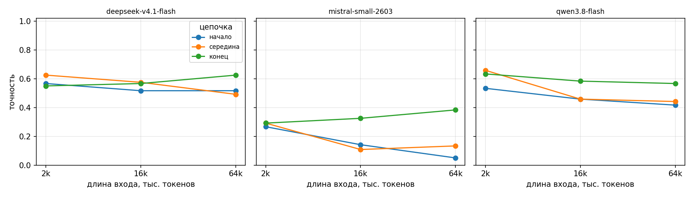

# Длина контекста и положение цепочки: length_bank

12 сценариев с n = 10, по одному вопросу на глубину (120 вопросов); в каждом условии одни и те же вопросы. Точность — среднее по глубинам (формула 2.3); в скобках — 95 % интервал бутстрепом по сценариям.

## deepseek-v4.1-flash

| Положение \ длина | 2k | 16k | 64k | Все длины |
|---|---|---|---|---|
| начало | 0,57 (0,50–0,63) | 0,52 (0,41–0,62) | 0,52 (0,38–0,64) | 0,53 |
| середина | 0,62 (0,55–0,70) | 0,57 (0,47–0,68) | 0,49 (0,35–0,62) | 0,56 |
| конец | 0,55 (0,50–0,60) | 0,57 (0,50–0,63) | 0,62 (0,56–0,68) | 0,58 |
| все положения | 0,58 | 0,55 | 0,54 | 0,56 |

Точность по глубине k (все положения):

| Длина | k = 0 | k = 1 | k = 2 | k = 3 | k = 4 | k = 5 | k = 6 | k = 7 | k = 8 | k = 9 |
|---|---|---|---|---|---|---|---|---|---|---|
| 2k | 0,97 | 0,81 | 0,56 | 0,47 | 0,31 | 0,33 | 0,47 | 0,36 | 0,72 | 0,81 |
| 16k | 0,72 | 0,72 | 0,44 | 0,56 | 0,33 | 0,36 | 0,44 | 0,39 | 0,78 | 0,78 |
| 64k | 0,69 | 0,64 | 0,44 | 0,56 | 0,33 | 0,44 | 0,42 | 0,44 | 0,75 | 0,72 |

Классы ответов по длине (доли):

| Длина | верно | более поздняя | более ранняя | отказ | прочее |
|---|---|---|---|---|---|
| 2k | 0,58 | 0,25 | 0,16 | 0,01 | 0,00 |
| 16k | 0,55 | 0,28 | 0,17 | 0,00 | 0,00 |
| 64k | 0,54 | 0,28 | 0,15 | 0,02 | 0,01 |

## mistral-small-2603

| Положение \ длина | 2k | 16k | 64k | Все длины |
|---|---|---|---|---|
| начало | 0,27 (0,22–0,32) | 0,14 (0,08–0,19) | 0,05 (0,00–0,12) | 0,15 |
| середина | 0,29 (0,23–0,36) | 0,11 (0,07–0,15) | 0,13 (0,07–0,19) | 0,18 |
| конец | 0,29 (0,23–0,37) | 0,33 (0,23–0,41) | 0,38 (0,32–0,45) | 0,33 |
| все положения | 0,28 | 0,19 | 0,19 | 0,22 |

Точность по глубине k (все положения):

| Длина | k = 0 | k = 1 | k = 2 | k = 3 | k = 4 | k = 5 | k = 6 | k = 7 | k = 8 | k = 9 |
|---|---|---|---|---|---|---|---|---|---|---|
| 2k | 0,92 | 0,42 | 0,06 | 0,19 | 0,14 | 0,14 | 0,14 | 0,25 | 0,47 | 0,11 |
| 16k | 0,50 | 0,31 | 0,14 | 0,14 | 0,08 | 0,11 | 0,00 | 0,11 | 0,47 | 0,06 |
| 64k | 0,33 | 0,25 | 0,11 | 0,22 | 0,14 | 0,11 | 0,06 | 0,22 | 0,31 | 0,14 |

Классы ответов по длине (доли):

| Длина | верно | более поздняя | более ранняя | отказ | прочее |
|---|---|---|---|---|---|
| 2k | 0,28 | 0,44 | 0,16 | 0,12 | 0,00 |
| 16k | 0,19 | 0,32 | 0,12 | 0,36 | 0,00 |
| 64k | 0,19 | 0,35 | 0,21 | 0,19 | 0,05 |

## qwen3.8-flash

| Положение \ длина | 2k | 16k | 64k | Все длины |
|---|---|---|---|---|
| начало | 0,53 (0,46–0,61) | 0,46 (0,38–0,54) | 0,42 (0,33–0,50) | 0,47 |
| середина | 0,66 (0,58–0,72) | 0,46 (0,40–0,52) | 0,44 (0,38–0,50) | 0,52 |
| конец | 0,63 (0,56–0,71) | 0,58 (0,50–0,66) | 0,57 (0,53–0,62) | 0,59 |
| все положения | 0,61 | 0,50 | 0,47 | 0,53 |

Точность по глубине k (все положения):

| Длина | k = 0 | k = 1 | k = 2 | k = 3 | k = 4 | k = 5 | k = 6 | k = 7 | k = 8 | k = 9 |
|---|---|---|---|---|---|---|---|---|---|---|
| 2k | 1,00 | 0,83 | 0,56 | 0,58 | 0,22 | 0,56 | 0,53 | 0,47 | 0,61 | 0,72 |
| 16k | 0,72 | 0,67 | 0,42 | 0,47 | 0,22 | 0,47 | 0,39 | 0,31 | 0,69 | 0,64 |
| 64k | 0,75 | 0,67 | 0,42 | 0,42 | 0,14 | 0,42 | 0,22 | 0,33 | 0,72 | 0,67 |

Классы ответов по длине (доли):

| Длина | верно | более поздняя | более ранняя | отказ | прочее |
|---|---|---|---|---|---|
| 2k | 0,61 | 0,18 | 0,16 | 0,01 | 0,04 |
| 16k | 0,50 | 0,19 | 0,26 | 0,04 | 0,01 |
| 64k | 0,47 | 0,21 | 0,28 | 0,04 | 0,00 |

