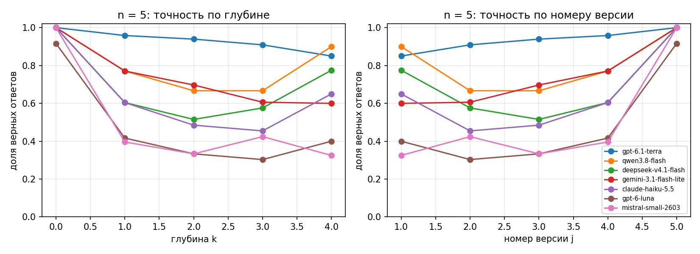
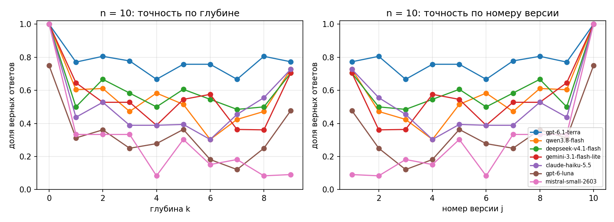

# Анализ по глубине и номеру версии: pilot_bank

Вопросы о глубине (без ложных предпосылок и вопросов о забытых версиях), формат «лог». В клетке — доля верных ответов; в заголовке столбца — число вопросов на модель.

## Точность по глубине k, n = 3

| Модель | k = 0 (6) | k = 1 (20) | k = 2 (20) |
|---|---|---|---|
| gpt-6.1-terra | 1,00 | 0,85 | 1,00 |
| qwen3.8-flash | 0,83 | 0,85 | 0,85 |
| deepseek-v4.1-flash | 1,00 | 0,60 | 0,85 |
| gemini-3.1-flash-lite | 1,00 | 0,65 | 0,80 |
| claude-haiku-5.5 | 0,83 | 0,40 | 0,65 |
| gpt-6-luna | 0,83 | 0,50 | 0,55 |
| mistral-small-2603 | 0,67 | 0,30 | 0,65 |

## Точность по номеру версии j = n − k, n = 3

| Модель | v1 | v2 | v3 |
|---|---|---|---|
| gpt-6.1-terra | 1,00 | 0,85 | 1,00 |
| qwen3.8-flash | 0,85 | 0,85 | 0,83 |
| deepseek-v4.1-flash | 0,85 | 0,60 | 1,00 |
| gemini-3.1-flash-lite | 0,80 | 0,65 | 1,00 |
| claude-haiku-5.5 | 0,65 | 0,40 | 0,83 |
| gpt-6-luna | 0,55 | 0,50 | 0,83 |
| mistral-small-2603 | 0,65 | 0,30 | 0,67 |

## Точность по глубине k, n = 5

| Модель | k = 0 (12) | k = 1 (48) | k = 2 (33) | k = 3 (33) | k = 4 (40) |
|---|---|---|---|---|---|
| gpt-6.1-terra | 1,00 | 0,96 | 0,94 | 0,91 | 0,85 |
| qwen3.8-flash | 1,00 | 0,77 | 0,67 | 0,67 | 0,90 |
| deepseek-v4.1-flash | 1,00 | 0,60 | 0,52 | 0,58 | 0,78 |
| gemini-3.1-flash-lite | 1,00 | 0,77 | 0,70 | 0,61 | 0,60 |
| claude-haiku-5.5 | 1,00 | 0,60 | 0,48 | 0,45 | 0,65 |
| gpt-6-luna | 0,92 | 0,42 | 0,33 | 0,30 | 0,40 |
| mistral-small-2603 | 1,00 | 0,40 | 0,33 | 0,42 | 0,33 |

## Точность по номеру версии j = n − k, n = 5

| Модель | v1 | v2 | v3 | v4 | v5 |
|---|---|---|---|---|---|
| gpt-6.1-terra | 0,85 | 0,91 | 0,94 | 0,96 | 1,00 |
| qwen3.8-flash | 0,90 | 0,67 | 0,67 | 0,77 | 1,00 |
| deepseek-v4.1-flash | 0,78 | 0,58 | 0,52 | 0,60 | 1,00 |
| gemini-3.1-flash-lite | 0,60 | 0,61 | 0,70 | 0,77 | 1,00 |
| claude-haiku-5.5 | 0,65 | 0,45 | 0,48 | 0,60 | 1,00 |
| gpt-6-luna | 0,40 | 0,30 | 0,33 | 0,42 | 0,92 |
| mistral-small-2603 | 0,33 | 0,42 | 0,33 | 0,40 | 1,00 |

## Точность по глубине k, n = 10

| Модель | k = 0 (12) | k = 1 (48) | k = 2 (36) | k = 3 (36) | k = 4 (36) | k = 5 (33) | k = 6 (33) | k = 7 (33) | k = 8 (36) | k = 9 (44) |
|---|---|---|---|---|---|---|---|---|---|---|
| gpt-6.1-terra | 1,00 | 0,77 | 0,81 | 0,78 | 0,67 | 0,76 | 0,76 | 0,67 | 0,81 | 0,77 |
| qwen3.8-flash | 1,00 | 0,60 | 0,61 | 0,47 | 0,58 | 0,52 | 0,30 | 0,42 | 0,47 | 0,73 |
| deepseek-v4.1-flash | 1,00 | 0,50 | 0,67 | 0,58 | 0,50 | 0,61 | 0,55 | 0,48 | 0,50 | 0,70 |
| gemini-3.1-flash-lite | 1,00 | 0,65 | 0,53 | 0,53 | 0,39 | 0,55 | 0,58 | 0,36 | 0,36 | 0,70 |
| claude-haiku-5.5 | 1,00 | 0,44 | 0,53 | 0,39 | 0,39 | 0,39 | 0,30 | 0,45 | 0,56 | 0,73 |
| gpt-6-luna | 0,75 | 0,31 | 0,36 | 0,25 | 0,28 | 0,36 | 0,18 | 0,12 | 0,25 | 0,48 |
| mistral-small-2603 | 1,00 | 0,33 | 0,33 | 0,33 | 0,08 | 0,30 | 0,15 | 0,18 | 0,08 | 0,09 |

## Точность по номеру версии j = n − k, n = 10

| Модель | v1 | v2 | v3 | v4 | v5 | v6 | v7 | v8 | v9 | v10 |
|---|---|---|---|---|---|---|---|---|---|---|
| gpt-6.1-terra | 0,77 | 0,81 | 0,67 | 0,76 | 0,76 | 0,67 | 0,78 | 0,81 | 0,77 | 1,00 |
| qwen3.8-flash | 0,73 | 0,47 | 0,42 | 0,30 | 0,52 | 0,58 | 0,47 | 0,61 | 0,60 | 1,00 |
| deepseek-v4.1-flash | 0,70 | 0,50 | 0,48 | 0,55 | 0,61 | 0,50 | 0,58 | 0,67 | 0,50 | 1,00 |
| gemini-3.1-flash-lite | 0,70 | 0,36 | 0,36 | 0,58 | 0,55 | 0,39 | 0,53 | 0,53 | 0,65 | 1,00 |
| claude-haiku-5.5 | 0,73 | 0,56 | 0,45 | 0,30 | 0,39 | 0,39 | 0,39 | 0,53 | 0,44 | 1,00 |
| gpt-6-luna | 0,48 | 0,25 | 0,12 | 0,18 | 0,36 | 0,28 | 0,25 | 0,36 | 0,31 | 0,75 |
| mistral-small-2603 | 0,09 | 0,08 | 0,18 | 0,15 | 0,30 | 0,08 | 0,33 | 0,33 | 0,33 | 1,00 |

## Влияние длины цепочки при фиксированной глубине

| Модель | k = 0: n = 3 / n = 5 / n = 10 | k = 1: n = 3 / n = 5 / n = 10 | k = 2: n = 3 / n = 5 / n = 10 |
|---|---|---|---|
| gpt-6.1-terra | 1,00 / 1,00 / 1,00 | 0,85 / 0,96 / 0,77 | 1,00 / 0,94 / 0,81 |
| qwen3.8-flash | 0,83 / 1,00 / 1,00 | 0,85 / 0,77 / 0,60 | 0,85 / 0,67 / 0,61 |
| deepseek-v4.1-flash | 1,00 / 1,00 / 1,00 | 0,60 / 0,60 / 0,50 | 0,85 / 0,52 / 0,67 |
| gemini-3.1-flash-lite | 1,00 / 1,00 / 1,00 | 0,65 / 0,77 / 0,65 | 0,80 / 0,70 / 0,53 |
| claude-haiku-5.5 | 0,83 / 1,00 / 1,00 | 0,40 / 0,60 / 0,44 | 0,65 / 0,48 / 0,53 |
| gpt-6-luna | 0,83 / 0,92 / 0,75 | 0,50 / 0,42 / 0,31 | 0,55 / 0,33 / 0,36 |
| mistral-small-2603 | 0,67 / 1,00 / 1,00 | 0,30 / 0,40 / 0,33 | 0,65 / 0,33 / 0,33 |

## Форматы памяти на одних и тех же вопросах

Берутся только вопросы о глубине, на которые есть ответы модели в обоих форматах.

| Модель | Лог | Список фактов | Вопросов |
|---|---|---|---|
| gpt-6.1-terra | 0,82 | 0,88 | 559 |
| qwen3.8-flash | 0,64 | 0,81 | 559 |
| deepseek-v4.1-flash | 0,62 | 0,80 | 559 |
| gemini-3.1-flash-lite | 0,61 | 0,87 | 559 |
| claude-haiku-5.5 | 0,53 | 0,70 | 559 |
| gpt-6-luna | 0,36 | 0,69 | 559 |
| mistral-small-2603 | 0,31 | 0,57 | 559 |

## Классы ответов на вопросы о глубине (лог), доли

| Модель | верно | более поздняя версия | более ранняя версия | отказ | значения нет во входе | отклонённое значение | значение другого слота | не определено |
|---|---|---|---|---|---|---|---|---|
| gpt-6.1-terra | 0,82 | 0,05 | 0,10 | 0,02 | 0,00 | 0,00 | 0,00 | 0,00 |
| qwen3.8-flash | 0,64 | 0,16 | 0,11 | 0,05 | 0,03 | 0,00 | 0,00 | 0,00 |
| deepseek-v4.1-flash | 0,62 | 0,15 | 0,14 | 0,07 | 0,00 | 0,00 | 0,00 | 0,01 |
| gemini-3.1-flash-lite | 0,61 | 0,11 | 0,18 | 0,09 | 0,00 | 0,01 | 0,00 | 0,00 |
| claude-haiku-5.5 | 0,53 | 0,08 | 0,16 | 0,21 | 0,01 | 0,01 | 0,00 | 0,02 |
| gpt-6-luna | 0,36 | 0,16 | 0,09 | 0,37 | 0,00 | 0,01 | 0,00 | 0,00 |
| mistral-small-2603 | 0,31 | 0,28 | 0,12 | 0,28 | 0,00 | 0,00 | 0,00 | 0,00 |

Отказы по типу сценария (доля отказов среди вопросов о глубине):

| Модель | без доп. события | несостоявшееся изменение | мягкая просьба забыть | строгая просьба забыть |
|---|---|---|---|---|
| gpt-6.1-terra | 0,00 | 0,00 | 0,00 | 0,12 |
| qwen3.8-flash | 0,03 | 0,01 | 0,00 | 0,25 |
| deepseek-v4.1-flash | 0,01 | 0,01 | 0,01 | 0,40 |
| gemini-3.1-flash-lite | 0,01 | 0,00 | 0,01 | 0,53 |
| claude-haiku-5.5 | 0,20 | 0,11 | 0,19 | 0,48 |
| gpt-6-luna | 0,38 | 0,28 | 0,19 | 0,72 |
| mistral-small-2603 | 0,40 | 0,17 | 0,04 | 0,42 |

